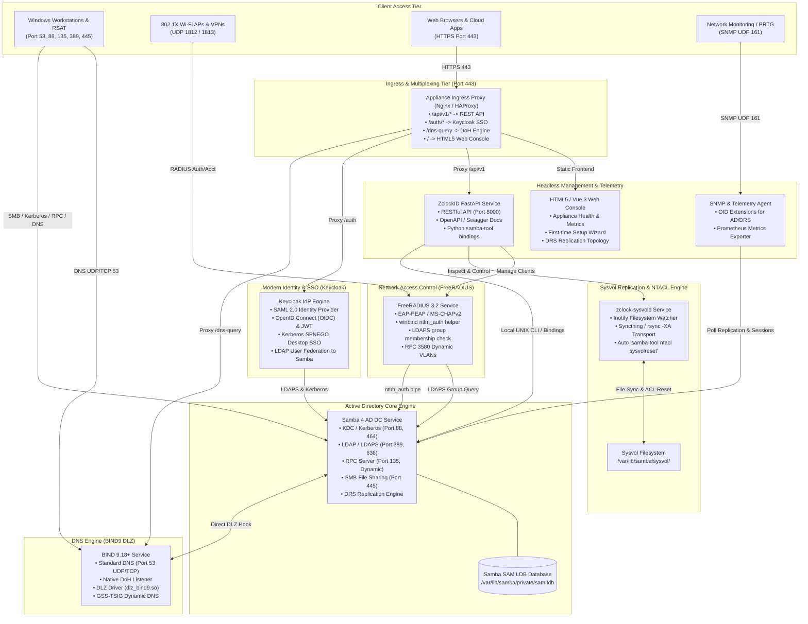
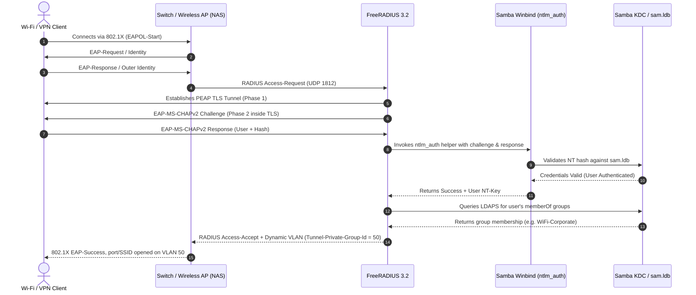
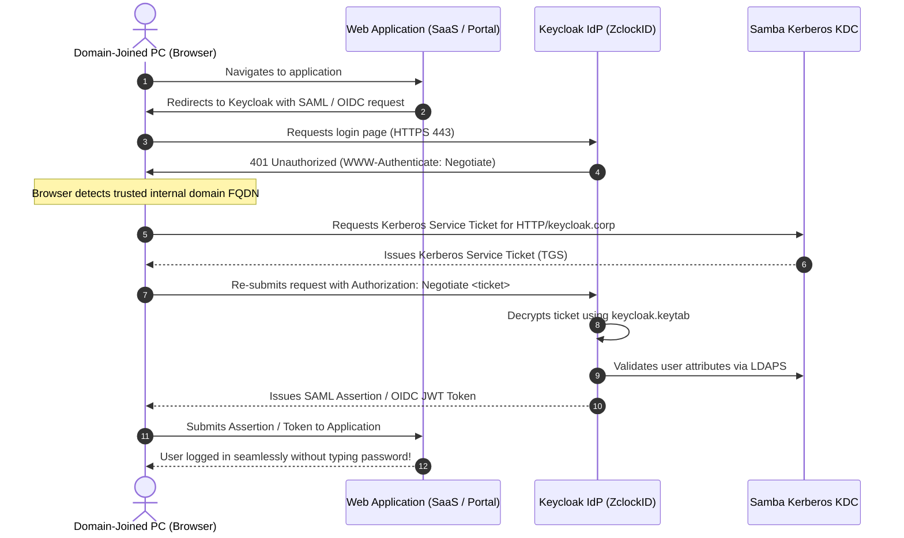
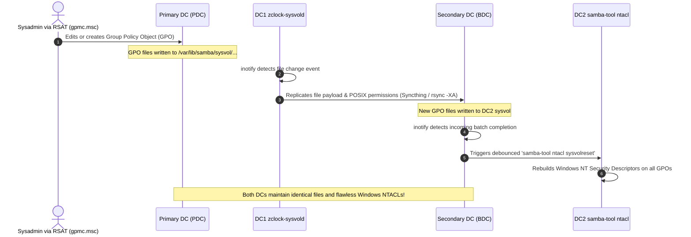

# ZclockID System Architecture Specification

## 1. System Architecture Overview

ZclockID is structured as an appliance where core directory services, encrypted DNS, enterprise RADIUS, identity federation, and headless management operate as coordinated, modular systemd services.



---

## 2. Ingress & Port Multiplexing Strategy

Because an enterprise appliance commonly exposes multiple HTTP-based services on standard TLS port `443`, ZclockID utilizes an internal reverse proxy (or native BIND path handling) to prevent socket collisions:

```
https://<appliance-fqdn>/
│
├── /dns-query                  ──► BIND 9.18 Native HTTP/DoH Listener (or dnsdist)
├── /api/v1/                    ──► ZclockID FastAPI Backend (localhost:8000)
├── /docs                       ──► Swagger OpenAPI Documentation
├── /auth/                      ──► Keycloak Modern SSO / SAML / OIDC (localhost:8080)
└── /* (root / assets)          ──► HTML5 Appliance Dashboard & Reporting UI
```

All non-HTTP directory protocols bind directly to standard dedicated network ports with zero proxy overhead.

---

## 3. Detailed Network Port Allocation Matrix

| Service | Port | Protocol | Scope | Direction | Purpose |
| :--- | :--- | :--- | :--- | :--- | :--- |
| **DNS** | `53` | UDP & TCP | LAN / WAN | Inbound | Standard Active Directory DNS resolution |
| **Kerberos KDC** | `88` | UDP & TCP | LAN | Inbound | User authentication and Kerberos Ticket Granting (TGT) |
| **NTP** | `123` | UDP | LAN | Inbound | AD time synchronization (`chrony` with MS-SNTP signing) |
| **RPC Endpoint Mapper** | `135` | TCP | LAN | Inbound | RPC service resolution (DRS, RSAT, SAMR) |
| **NetBIOS Name / Session** | `137-139` | UDP / TCP | LAN | Inbound | Legacy NetBIOS name resolution and browsing |
| **LDAP** | `389` | TCP & UDP | LAN | Inbound | Active Directory directory queries & dynamic DNS |
| **Active Directory Web (DoH/GUI/SSO)**| `443` | TCP | LAN / WAN | Inbound | DNS-over-HTTPS, REST API, Web Console, Keycloak |
| **SMB (Server Message Block)** | `445` | TCP | LAN | Inbound | GPO download, Netlogon scripts, IPC$ RPC transport |
| **Kerberos Password (kpasswd)** | `464` | UDP & TCP | LAN | Inbound | Domain password change protocol |
| **LDAPS (LDAP over SSL)** | `636` | TCP | LAN | Inbound | Secure directory queries & Keycloak/RADIUS binding |
| **Global Catalog (GC)** | `3268` | TCP | LAN | Inbound | Forest-wide directory queries |
| **Global Catalog SSL** | `3269` | TCP | LAN | Inbound | Encrypted forest-wide directory queries |
| **FreeRADIUS Auth** | `1812` | UDP | LAN | Inbound | 802.1X Access-Request authentication |
| **FreeRADIUS Accounting**| `1813` | UDP | LAN | Inbound | RADIUS session start/stop/interim accounting |
| **Sysvol Sync (Syncthing)** | `22000` | TCP | DC-to-DC | Mutual | Encrypted P2P Sysvol replication |
| **Sysvol Sync Discovery** | `21027` | UDP | DC-to-DC | Mutual | Local broadcast discovery between DCs |
| **SNMP Daemon** | `161` | UDP | Mgmt LAN | Inbound | SNMP appliance telemetry |
| **Prometheus Exporter** | `9100` | TCP | Mgmt LAN | Inbound | Node and Samba metrics scraping |
| **RPC Dynamic Range** | `49152-65535` | TCP | LAN / Inter-DC | Mutual | High-port dynamic RPC for DRS replication & RSAT |

---

## 4. Authentication & Data Flows

### 4.1. Enterprise 802.1X Authentication Flow (FreeRADIUS + Samba AD)



---

### 4.2. Web SSO & Kerberos SPNEGO Flow (Keycloak + Samba AD)



---

### 4.3. Multi-DC Sysvol & NTACL Replication Flow



---

## 5. Filesystem Layout & Storage Allocation

| Path | Purpose | Backup Priority |
| :--- | :--- | :--- |
| `/etc/samba/smb.conf` | Core Samba Active Directory configuration | High |
| `/var/lib/samba/private/` | AD database (`sam.ldb`), secrets, Kerberos keytabs | Critical (Full AD snapshot) |
| `/var/lib/samba/sysvol/` | Sysvol share: GPOs, logon scripts, policies | Critical (Synced across DCs) |
| `/etc/bind/named.conf*` | BIND9 DLZ & DoH options and zones | High |
| `/etc/freeradius/3.0/` | RADIUS NAS clients, inner-tunnel, mschap, ldap configs | High |
| `/etc/zclockid/` | ZclockID appliance configuration & API secrets | High |
| `/opt/zclockid/api/` | Headless REST API backend codebase (FastAPI) | Managed by updater |
| `/opt/zclockid/web/` | HTML5 Web Dashboard static build | Managed by updater |
| `/var/log/zclockid/` | Structured appliance telemetry & audit logs | Rotated via logrotate |

