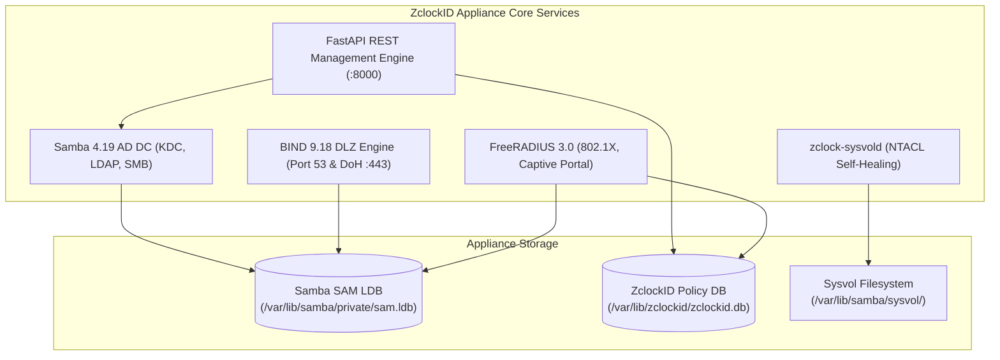
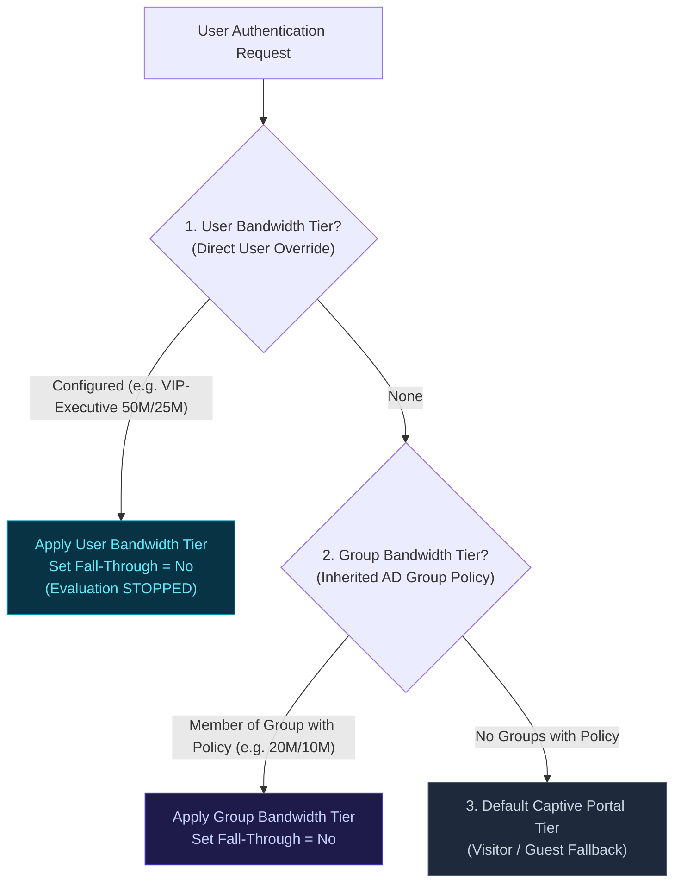

# ZclockID Appliance Administrator & User Guide

**Document Version:** 1.0  
**Target Platform:** ZclockID Enterprise Appliance (Ubuntu 24.04 LTS / Samba 4.19+ / FreeRADIUS 3.0+ / BIND 9.18+)  
**Target Audience:** Systems Engineers, Network Administrators, and IT Infrastructure Operations  

---

## Table of Contents
1. [Introduction & Architectural Concept](#1-introduction--architectural-concept)
2. [Hardware Specifications & Sizing Guide](#2-hardware-specifications--sizing-guide)
3. [Network Topology & Port Matrix](#3-network-topology--port-matrix)
4. [Installation & Deployment](#4-installation--deployment)
5. [First-Time Setup & Domain Provisioning](#5-first-time-setup--domain-provisioning)
6. [Active Directory & Identity Management](#6-active-directory--identity-management)
7. [FreeRADIUS 802.1X & Captive Portal Bandwidth Management](#7-freeradius-8021x--captive-portal-bandwidth-management)
8. [Encrypted DNS (BIND9 DLZ & DNS-over-HTTPS)](#8-encrypted-dns-bind9-dlz--dns-over-https)
9. [Sysvol Synchronization & NTACL Self-Healing](#9-sysvol-synchronization--ntacl-self-healing)
10. [Hybrid Identity & Cloud Synchronization (Microsoft Entra ID / M365)](#10-hybrid-identity--cloud-synchronization-microsoft-entra-id--m365)
11. [Appliance Host Firewall & System Hardening](#11-appliance-host-firewall--system-hardening)
12. [Enterprise NTP & SNMP Monitoring](#12-enterprise-ntp--snmp-monitoring)
13. [Appliance Operations, Maintenance, Backups & Update Center](#13-appliance-operations-maintenance-backups--update-center)

---

## 1. Introduction & Architectural Concept

**ZclockID** is a high-performance, open-source Active Directory Domain Controller (AD DC) and Identity & Access Management (IAM) appliance built on Ubuntu Linux LTS. 

### Why ZclockID?
Traditional multi-service Linux DC distributions (such as Zentyal Server) suffer from monolithic design bloat—bundling firewalls, HTTP proxies, webmail, and print servers into a single operating system. This complexity leads to broken package dependencies during upgrades, memory exhaustion, and fragile DNS/Kerberos configurations.

ZclockID eliminates all extraneous bloat. It focuses exclusively on core enterprise identity, network access control, and directory synchronization:
* **Samba 4 AD DC:** Full multi-master Microsoft DRS replication, Kerberos KDC, LDAP/LDAPS, and native Windows RSAT management.
* **Decoupled FreeRADIUS 3.0:** High-speed 802.1X enterprise network authentication, Dynamic VLAN steering (RFC 3580), and granular Captive Portal rate limiting.
* **BIND 9.18+ DLZ & Encrypted DNS-over-HTTPS (DoH):** Direct memory coupling with Samba `sam.ldb` database for zero-latency dynamic DNS updates and tamper-proof HTTP/2 encrypted DNS queries.
* **Headless REST API First:** All appliance configurations, user provisioning, and service controls are exposed via a documented FastAPI backend and an intuitive HTML5/Tailwind administration dashboard.



---

## 2. Hardware Specifications & Sizing Guide

ZclockID can be deployed on bare-metal Dell PowerEdge/HP ProLiant servers or virtualized on VMware ESXi, Proxmox VE, Hyper-V, or KVM.

### Recommended Sizing Matrix

| Metric / Scale | Tier 1: Small Office / Branch | Tier 2: Mid-Enterprise (Default) | Tier 3: Large Enterprise / Data Center |
| :--- | :--- | :--- | :--- |
| **Domain Users** | Up to 250 users | 250 – 2,500 users | 2,500 – 25,000+ users |
| **Domain Joined PCs** | Up to 150 PCs | 150 – 1,500 PCs | 1,500 – 15,000+ PCs |
| **Concurrent RADIUS Sessions** | Up to 100 sessions | 100 – 1,000 sessions | 1,000 – 10,000+ sessions |
| **DNS Queries / sec (QPS)** | Up to 500 QPS | 500 – 3,500 QPS | 3,500 – 15,000+ QPS |
| **vCPU / CPU Cores** | 2 vCPU (2.0 GHz+) | 4 vCPU (2.4 GHz+) | 8 vCPU (3.0 GHz+) |
| **RAM (Memory)** | 4 GB | 8 GB | 16 GB – 32 GB |
| **Storage Capacity** | 40 GB SSD / NVMe | 80 GB SSD / NVMe | 160 GB+ NVMe (RAID 10) |
| **Storage Throughput** | Standard SATA SSD | Enterprise NVMe / SAS | PCIe Gen4 NVMe (Low Latency) |
| **NIC Interfaces** | 1x 1GbE | 2x 1GbE (LACP Bond) | 2x 10GbE (SFP+ LACP Bond) |

### Storage Allocation Breakdown (Default 80 GB Footprint)
* **OS & System Libraries (`/`):** 15 GB
* **Active Directory SAM LDB (`/var/lib/samba/private`):** 10 GB (Holds up to 50,000 user/group objects)
* **Sysvol Directory & Policies (`/var/lib/samba/sysvol`):** 20 GB (Holds Group Policy templates, scripts, software packages)
* **ZclockID Database & Backups (`/var/lib/zclockid`):** 15 GB
* **System & Audit Logs (`/var/log`):** 20 GB (Configured with logrotate)

> [!IMPORTANT]
> **Disk I/O Latency:** Active Directory relies heavily on low-latency synchronous write operations to `sam.ldb`. Always ensure the virtual disk is backed by SSD or NVMe datastores. Avoid placing Domain Controllers on slow mechanical spinning disks or high-latency NFS shares.

---

## 3. Network Topology & Port Matrix

ZclockID requires specific ports open on the internal firewall to serve Windows clients, Active Directory replication partners, and RADIUS NAS devices.

### Port Matrix

| Port / Protocol | Service | Description | Direction |
| :--- | :--- | :--- | :--- |
| **53 UDP / TCP** | DNS | BIND9 Standard Domain Name Resolution | Inbound from LAN Clients / Subnets |
| **88 UDP / TCP** | Kerberos KDC | Active Directory Authentication | Inbound from Domain Workstations |
| **123 UDP** | NTP | Network Time Protocol (Chrony/Samba) | Inbound / Outbound (Clock sync) |
| **135 TCP** | RPC Endpoint | Microsoft Windows Remote Procedure Call | Inbound from RSAT / Workstations |
| **389 UDP / TCP** | LDAP | Lightweight Directory Access Protocol | Inbound from Clients / NAS devices |
| **445 TCP** | SMB / CIFS | Active Directory Sysvol & Policy Sharing | Inbound from Domain Workstations |
| **464 UDP / TCP** | Kerberos Passwd | Windows Password Change Protocol | Inbound from Domain Workstations |
| **636 TCP** | LDAPS | Secure LDAP over TLS/SSL | Inbound from Secure Apps / FreeRADIUS |
| **1812 UDP** | RADIUS Auth | FreeRADIUS 802.1X / Captive Portal Auth | Inbound from Wi-Fi APs / Firewalls |
| **1813 UDP** | RADIUS Acct | FreeRADIUS Accounting & Session Limits | Inbound from Wi-Fi APs / Firewalls |
| **443 TCP** | HTTPS / DoH | Web UI Console, REST API & DoH | Inbound from Admins & Clients |
| **8000 TCP** | FastAPI Backend | Local API Listener (Internal / Nginx) | Localhost (Reverse Proxied) |

---

## 4. Installation & Deployment

### Operating System Prerequisites
* **Operating System:** Ubuntu 24.04 LTS Server (Minimal Install recommended)
* **Static IP Address:** ZclockID must have a permanent static IPv4 address. Do not use dynamic DHCP on a Domain Controller.
* **FQDN / Hostname:** Set a fully-qualified domain name (e.g. `dc1.example.com`).

### Automated Installation via Package Script

1. **Clone the ZclockID Repository:**
   ```bash
   cd /opt
   git clone https://github.com/atanu/Inet-ZclockID.git
   cd Inet-ZclockID
   ```

2. **Run the Installer:**
   ```bash
   sudo ./installer/install.sh
   ```
   The installer automatically:
   * Installs prerequisite packages: `samba`, `winbind`, `libpam-winbind`, `libnss-winbind`, `bind9`, `freeradius`, `freeradius-ldap`, `python3-pip`, `nginx`.
   * Sets up directory structures at `/opt/zclockid` and `/var/lib/zclockid`.
   * Configures Python virtual environment and installs FastAPI backend dependencies.
   * Registers systemd units: `zclock-api.service`, `zclock-sysvold.service`.
   * Provisions Nginx reverse proxy with SSL certificate terminating at `https://<Appliance-IP>/`.

3. **Verify Installed Services:**
   ```bash
   systemctl status zclock-api
   systemctl status nginx
   ```

---

## 5. First-Time Setup & Domain Provisioning

When launching ZclockID for the first time, navigate to `https://<Appliance-IP>/` in your web browser.

### Option A: Provision a New Active Directory Forest (Primary DC)
To create a new root domain:
1. Select **"Provision New Forest / Primary DC"**.
2. **Domain Realm (FQDN):** Enter your enterprise realm (e.g., `INETCSC.NET`).
3. **NetBIOS Domain Name:** Enter the short NetBIOS name (e.g., `INETCSC`).
4. **Administrator Password:** Set a complex password meeting enterprise complexity requirements (minimum 8 characters, uppercase, lowercase, numbers, and symbols).
5. **DNS Forwarder:** Provide upstream DNS resolvers (e.g., `1.1.1.1, 8.8.8.8`).
6. Click **"Provision Domain Controller"**. The backend invokes `samba-tool domain provision` and automatically establishes BIND9 DLZ links.

### Option B: Join as an Additional Domain Controller (Secondary DC)
To join an existing Windows or Samba Active Directory domain for high availability:
1. Select **"Join Existing Domain (Secondary DC)"**.
2. **Existing Domain Realm:** Enter existing realm (e.g., `INETCSC.NET`).
3. **Primary DC IP Address:** IP of the existing PDC (e.g., `192.168.1.23`).
4. **Domain Administrator Credentials:** Administrator username and password.
5. Click **"Join Domain & Sync DRS"**. ZclockID will execute `samba-tool domain join` and initiate initial DRS directory replication.

---

## 6. Active Directory & Identity Management

Navigate to the **Directory Services** tab in the ZclockID Web Console to manage users, groups, and computers.

### Managing Domain Users

```
+------------------------------------------------------------------------------------------------------------------------+
| Active Directory Domain Users                                                          [ + New User ]  [ Refresh ]     |
+------------------------------------------------------------------------------------------------------------------------+
| User Account & UPN | Full Name    | Department   | User Bandwidth Tier | Group Bandwidth Tier     | State  | Actions   |
+--------------------+--------------+--------------+---------------------+--------------------------+--------+-----------+
| rajesh.kumar       | Rajesh Kumar | Infrastructure| VIP-Executive (50M) | Staff-Standard (20M)     | ACTIVE | [Edit] [X]|
| anita.sharma       | Anita Sharma | Finance      | None                | Staff-Standard (20M)     | ACTIVE | [Edit] [X]|
| administrator      | Administrator| Built-in     | None                | None                     | ACTIVE | [Edit]    |
+------------------------------------------------------------------------------------------------------------------------+
```

#### Creating a New User:
1. Click **"+ New User"**.
2. Fill in account details:
   * **sAMAccountName (Username):** e.g., `rajesh.kumar`
   * **Password:** Account password
   * **Full Name, Email, Department & Mobile**
   * **Assigned Security Groups:** Multi-select AD groups (e.g., `Corporate-Users`, `DevOps`).
   * **User Bandwidth Tier:** Select an explicit individual override or leave as **None** to inherit group limits.
3. Click **"Save User"**.

#### Built-in vs Normal User Visibility:
* By default, system-internal service accounts (`krbtgt`, `Guest`, `dns-*`) are hidden from view to avoid clutter.
* The primary **`Administrator`** account is always visible for administrative credential rotation.
* Check the **"Show System & Service Accounts"** box in the toolbar if you need to inspect or audit low-level accounts.

### Managing Active Directory Security Groups
* Groups can be created under the **Security Groups** sub-tab.
* Members can be assigned to multiple security groups.
* Groups can have a **Bandwidth Policy** assigned, which automatically propagates to all member users who do not have an individual override.

---

### Microsoft Windows RSAT (Remote Server Administration Tools) Integration

ZclockID implements full Active Directory RPC endpoints (DRSUAPI, SAMR, LSARPC, Netlogon), allowing administrators to manage all users, groups, GPOs, DNS zones, and sites natively from Windows 10 and Windows 11 using **Microsoft RSAT**.

#### 1. Installing RSAT on Windows
* **Windows 11 / Windows 10 (Version 1809 and later):** RSAT is included as an *Optional Feature*.
* **Via Settings:**
  1. Open **Settings -> System -> Optional features** (or **Apps -> Optional features** on Windows 10).
  2. Click **View features** (or **Add a feature**).
  3. Search for and select:
     * `RSAT: Active Directory Domain Services and Lightweight Directory Services Tools`
     * `RSAT: Group Policy Management Tools`
     * `RSAT: DNS Server Tools`
     * `RSAT: Server Manager`
  4. Click **Install**.
* **Via PowerShell (Administrator One-Liner):**
  ```powershell
  Get-WindowsCapability -Name RSAT* -Online | Add-WindowsCapability -Online
  ```

#### 2. Connecting to ZclockID
1. **Set Preferred DNS:** In the Windows client network adapter IPv4 properties, point the Preferred DNS server to your ZclockID appliance IP (e.g., `192.168.1.41`).
2. **Join Domain:**
   * Press `Win + R`, type `sysdm.cpl`, and press Enter.
   * Under **Computer Name**, click **Change...**
   * Select **Domain** and enter your AD realm (e.g., `INET.NET`).
   * Authenticate using `Administrator` credentials.
   * Reboot when prompted.
3. **Sign In:** Log into Windows using your Domain Administrator account (e.g. `Administrator@inet.net` or `INET\Administrator`).

#### 3. Native MMC Snap-in Reference

| Tool / MMC Command | Name | What You Can Manage |
| :--- | :--- | :--- |
| `dsa.msc` | **Active Directory Users and Computers** | OUs, User accounts, Security Groups, Computer objects, Passwords, Account Lockouts, and Department attributes. |
| `gpmc.msc` | **Group Policy Management Console** | Create, edit, and link Group Policy Objects (GPOs), configure Sysvol policies, password policies, and drive mappings. |
| `dnsmgmt.msc` | **DNS Server Manager** | BIND9 DLZ Forward and Reverse Lookup Zones, A, AAAA, CNAME, MX, TXT, and SRV service location records. |
| `dssite.msc` | **Active Directory Sites and Services** | Multi-site subnets, inter-site replication topology, DRS replication schedules, and NTDS settings. |
| `adsiedit.msc` | **ADSI Edit** | Low-level directory schema, configuration partition, and raw LDAP attributes. |

> [!TIP]
> Both the ZclockID Web Console and Windows RSAT operate directly against the same Samba `sam.ldb` directory and BIND9 DLZ engine. Changes made in RSAT reflect immediately in the web portal and vice versa.

---

## 7. RADIUS & Network Access Control (General & Advance)

The **Radius** management suite in ZclockID is organized into two primary tabs for clean operational clarity:

### 1. General Mode
* **NAS Clients & APs:** Authorized Network Access Servers (Switches, pfSense firewalls, and Wi-Fi Access Points) allowed to authenticate supplicants against Active Directory with shared secret keys.
* **Bandwidth & Rate Limits:** Decoupled Captive Portal rate-limiting profiles defining download/upload speeds, session timeouts, and daily quotas (with `0 Mbps` Unlimited support).
* **EAP & Certificates:** 802.1X PEAP/MS-CHAPv2 and TLS certificate management.
* **Live Sessions & Accounting:** Real-time active RADIUS sessions, interim update intervals, and historical accounting data.

### 2. Advance Mode
* **MAB (MAC Authentication Bypass):** Authorize headless devices (MFP printers, VoIP phones, IoT sensors, IP cameras) using MAC addresses with static IP assignment and dedicated rate limits.
* **Custom Attributes (VSA):** Inject vendor-specific RADIUS check/reply items (such as `Cisco-AVPair`, `Mikrotik-Rate-Limit`, or `RFC 3580` Dynamic VLAN IDs: `Tunnel-Type`, `Tunnel-Medium-Type`, `Tunnel-Private-Group-Id`) globally or per-group.
* **Engine Parameters & Logging:** Adjust FreeRADIUS daemon ports, thread pools, and brute-force audit logging.
* **View Raw Config:** Live pfSense-style inspector for `/etc/freeradius/3.0/users`, `clients.conf`, `mschap`, and `eap.conf`.

---

### Decoupled Bandwidth Architecture & Policy Objects

Bandwidth profiles are **independent QoS policy objects** defined under **Radius -> General -> Bandwidth & Rate Limits**:

* **Pure Policy Objects:** Bandwidth profiles act solely as reusable QoS rate limit definitions. They do not store default flags, eliminating ambiguity.
* **Unlimited Wire Speed (0 Mbps):** Setting Download or Upload to `0` designates **Unlimited** wire speed. In FreeRADIUS, this automatically omits rate-limiting attributes (`WISPr-Bandwidth-Max-*` and `Mikrotik-Rate-Limit`), allowing full hardware line rate.
* **Association Hierarchy:** Bandwidth profiles can be assigned to:
  1. An individual **Domain User** as an explicit override.
  2. An entire **Active Directory Security Group** (propagating to all member users).
  3. The **Global Fallback Tier** for guests and newly self-registered accounts (managed under **Self-Registration Settings**).

---

### Self-Registration & Captive Portal Provisioning Settings

The appliance provides an integrated self-registration workflow for guest Wi-Fi and Bring-Your-Own-Device (BYOD) onboarding:

* **Active Directory Password Policy Enforcement:** Real-time client-side checklist and strict backend verification requiring passwords to satisfy Active Directory complexity (minimum 8 characters, at least 3 categories: uppercase, lowercase, numbers, and symbols, with username and name exclusion).
* **Dynamic Organization Departments (Max 100):** Administrators can define corporate departments under Settings (e.g. `DevOps`, `Finance`, `Operations`). The registration portal dynamically renders this exact list in the department dropdown.
* **Default Provisioning Domain:** Dropdown selector offering the Primary AD Forest Root Realm alongside any registered alternate UPN/SPN suffixes (e.g. `example.com`, `corp.inet.net`). New users are automatically created with this UPN domain.
* **Default Security Group:** Dropdown populated directly from Active Directory groups (defaults to `Domain Users` if blank or unselected).
* **Default Bandwidth Profile:** Dropdown populated from the Bandwidth & Rate Limit policy objects (defaults to `None` if unselected).
  * When set, this profile acts as the **Global Fallback Captive Portal Profile** in FreeRADIUS for any unregistered or unassigned client.
  * When a self-registered user is approved (or verifies via SMS OTP), this bandwidth tier is automatically provisioned into their Active Directory LDAP `info` attribute and local database.
* **Active Directory Identity Tagging:** All self-registered users automatically receive native Active Directory schema attributes:
  * `department`: User's selected organization department.
  * `employeeType`: Stored as `Self-Registered`.
  * `description`: Stored as `Self-Registered via ZclockID Portal` (visible in RSAT `dsa.msc`).
  * `comment`: Tagged with `ZCLOCKID_SELF_REGISTERED`.
  * **Domain Users Table Badge:** Self-registered accounts display a distinct `Self-Registered` badge distinguishing them from accounts created by administrators.
* **SMS Gateway Integration:** Supports simulated gateway, Twilio, Fast2SMS, MSG91, or custom webhook HTTP GET/POST endpoints for instant OTP delivery.

---

### Precedence & Evaluation Rules: User Tier vs Group Tier

When a user connects to Wi-Fi or Captive Portal, FreeRADIUS evaluates rate limits in strict hierarchical order:



#### Concrete Example:
| User Account | Groups | User Bandwidth Tier | Group Bandwidth Tier | **Active Effective Bandwidth** | Reason |
| :--- | :--- | :--- | :--- | :--- | :--- |
| `rajesh.kumar` | `testgrp` | `VIP-Executive (50M/25M)` | `Staff-Standard (20M/10M)` | **`50M / 25M`** | User explicit override takes priority. |
| `anita.sharma` | `testgrp` | `None` | `Staff-Standard (20M/10M)` | **`20M / 10M`** | Inherited from security group `testgrp`. |
| `contractor.1` | *(none)* | `None` | `None` | **Default Portal Tier** | Fallback policy applied. |

#### Multi-Group Conflict Resolution:
If a user is a member of multiple AD groups with competing bandwidth policies, ZclockID automatically ranks the policies and applies the **highest download speed** (with `0` / Unlimited holding the absolute highest priority).

### FreeRADIUS Configuration Sync
Whenever you save a user, group, or bandwidth profile, ZclockID automatically re-generates `/etc/freeradius/3.0/users` and safely reloads the FreeRADIUS daemon without dropping active connections.

---

## 8. Encrypted DNS (BIND9 DLZ & DNS-over-HTTPS)

ZclockID integrates **BIND 9.18+ DLZ** directly with Samba AD DC:

* **Zero Replication Delay:** DNS records added via RSAT (`dnsmgmt.msc`) or the ZclockID Web Console write directly into Samba's `sam.ldb`. BIND9 resolves updates immediately from shared memory without Zone file transfers.
* **DNS-over-HTTPS (DoH):** Clients supporting RFC 8484 can send encrypted DNS queries directly to `https://<Appliance-IP>/dns-query`.
* **Forwarders:** Upstream DNS forwarders (e.g. Quad9, Cloudflare) can be configured via **DNS Services -> Forwarders** with automatic health checking.

---

## 9. Sysvol Synchronization & NTACL Self-Healing

The native Samba Active Directory engine replicates directory objects (users, groups, computers) via Microsoft DRS, but does not replicate Group Policy files (`sysvol`).

ZclockID includes a dedicated system daemon: **`zclock-sysvold`**.

### How `zclock-sysvold` Works:
1. **Filesystem Watcher:** Inotify monitors `/var/lib/samba/sysvol/` for newly created or modified GPOs.
2. **Bi-Directional Transfer:** Propagates GPO files across all secondary domain controllers using authenticated, encrypted transport.
3. **NTACL Self-Healing:** After replication, `zclock-sysvold` automatically validates and repairs Windows Extended Security Attributes (`security.NTACL`), preventing GPO permission corruption (`Access Denied` errors in `gpmc.msc`).

---

## 10. Hybrid Identity & Cloud Synchronization (Microsoft Entra ID / M365)

A critical requirement for modern Active Directory Domain Controllers is **Hybrid Identity Synchronization** with Microsoft 365 and Microsoft Entra ID (Azure AD). When enterprise employees and groups are created or modified on-premises in ZclockID, their accounts, attributes, and security states synchronize seamlessly with cloud services (Teams, Outlook, OneDrive, SharePoint, Azure).

ZclockID supports **two distinct synchronization pathways**:

### Architecture Comparison

```
Option 1: Native Direct Linux Sync (Zero Windows Server Licenses)
┌─────────────────────────────────┐                 ┌─────────────────────────────────┐
│        ZclockID Appliance       │                 │     Microsoft Cloud (M365)      │
│  ┌───────────┐   ┌────────────┐ │  OAuth2 / HTTPS │  ┌───────────────────────────┐  │
│  │ Samba AD  │──►│ zclock-    │─┼────────────────┼─►│ Microsoft Entra ID (Azure)│  │
│  │ (sam.ldb) │   │ azuresync  │ │   (Port 443)    │  │ • Users, Groups, PHS      │  │
│  └───────────┘   └────────────┘ │                 │  │ • Exchange Online / M365  │  │
└─────────────────────────────────┘                 └─────────────────────────────────┘

Option 2: Microsoft Entra Connect (via Windows Member Server)
┌──────────────────┐         LDAP / RPC (389, 135)       ┌──────────────────────────┐         HTTPS 443         ┌─────────────────────┐
│    ZclockID      │◄────────────────────────────────────│   Windows Member Server  │──────────────────────────►│ Microsoft Entra ID │
│  (Samba AD DC)   │                                     │ (Microsoft Entra Connect)│                           │       (M365)        │
└──────────────────┘                                     └──────────────────────────┘                           └─────────────────────┘
```

| Dimension | Option 1: Native Direct Linux Sync | Option 2: Microsoft Entra Connect (Windows) |
| :--- | :--- | :--- |
| **Windows Server Required** | **NO (100% Linux Appliance)** | **YES (Requires Windows Server VM)** |
| **Microsoft OS Licensing** | **$0 (Zero CALs / Zero Windows licenses)** | ~$1,069 (Windows Server OS License) |
| **Synchronization Engine** | Python daemon (`zclock-azuresync`) + MS Graph API | Official Microsoft Entra Connect MSI agent |
| **Password Synchronization** | Supported via NT-hash export & Graph DirSync | Supported via native Windows DCSync RPC |
| **Management Interface** | ZclockID Web Console & Headless REST API | Microsoft Entra Connect Wizard on Windows desktop |
| **Vendor Support** | Supported by ZclockID Appliance | Supported directly by Microsoft Support |
| **Writeback Features** | One-way on-prem to cloud (Samba $\rightarrow$ Azure) | Bi-directional (Password & Device Writeback) |

### Option 1 Configuration: Native Direct Linux Sync (`zclock-azuresync`)

#### 1. Prerequisites in Azure Portal
1. Navigate to **Microsoft Entra ID > App Registrations > New Registration**:
   * Name: `ZclockID-CloudSync`
   * Supported Account Types: Single Tenant (Accounts in this organizational directory only)
2. Grant **Application Permissions** (Microsoft Graph API):
   * `User.ReadWrite.All`
   * `Group.ReadWrite.All`
   * `Directory.ReadWrite.All`
   * `Domain.Read.All`
   * *(Click "Grant admin consent for your organization")*.
3. Generate a **Client Secret** under **Certificates & secrets** and copy the **Secret Value**, **Application (Client) ID**, and **Directory (Tenant) ID**.

#### 2. Configuring Cloud Sync in ZclockID Web Console
1. Navigate to **Cloud Sync > Microsoft Entra ID** in the Web Console.
2. Enter your **Tenant ID**, **Client ID**, and **Client Secret**.
3. Select your Target OU filter (default: `OU=Users,DC=corp,DC=example,DC=com`).
4. Set your Sync Interval (e.g. 15 minutes) or click **Sync Now** for immediate trigger.
5. Live telemetry, last synchronization timestamps, and synced account counts appear in real time.

---

## 11. Appliance Host Firewall & System Hardening

ZclockID includes an enterprise packet filtering firewall and OpenSSH hardening layer directly integrated into the Web Console and headless REST API.

### Host Firewall & Port Protection
* **Default Drop Policy:** Drops all unsolicited incoming traffic while permitting outgoing traffic and explicitly allowed services.
* **Firewall (ON/OFF) Toggle:** Master toggle switch allows administrators to enable or disable packet filtering live without dropping SSH/HTTPS access.
* **Multi-Subnet Ingress Rules:** Rules support specifying multiple comma-separated IP subnets or CIDRs (e.g. `192.168.1.0/24, 10.10.0.0/24, 180.92.168.34/32`).
* **Anti-Lockout Zero-Risk Guard:** The Web Console detects the administrator's live client IP and displays an **ANTI-LOCKOUT ARMED** badge. An interactive "+ Add Current IP (/32)" button is provided in rule creation modals to instantly safeguard administrative connectivity.
* **Unified Rules Management:** Full CRUD (edit and delete) on all default and custom rules, accompanied by a 1-click **Revert to Default Template** button to restore standard Active Directory baseline rules.

### Standard Baseline Port Matrix
| Port / Protocol | Service | Description |
| :--- | :--- | :--- |
| **22 / TCP** | OpenSSH | Administrative SSH access |
| **443 / TCP** | HTTPS Proxy | Web Console, REST API & DoH |
| **80 / TCP** | HTTP | Redirect to HTTPS |
| **53 / TCP & UDP** | BIND9 DLZ | Active Directory DNS resolution |
| **88, 464 / TCP & UDP** | Kerberos | KDC Authentication & Password Change |
| **389, 636 / TCP** | LDAP / LDAPS | Active Directory Directory Service |
| **3268, 3269 / TCP** | Global Catalog | Active Directory GC & GC-SSL |
| **445, 139 / TCP** | SMB / NetBIOS | Sysvol replication & File sharing |
| **137, 138 / UDP** | NetBIOS | NetBIOS Name & Datagram Services |
| **135, 49152:65535 / TCP** | MS-RPC | RPC Endpoint Mapper & Dynamic RPC |
| **1812, 1813 / UDP** | FreeRADIUS | 802.1X Authentication & Accounting |
| **123 / UDP** | Chrony NTP | Enterprise network time sync |
| **161 / UDP** | Net-SNMP | Appliance telemetry & monitoring |

### OpenSSH Hardening Baseline
* Located under **Access Control > Host Firewall & Hardening**.
* Configure root login restrictions (`PermitRootLogin no / prohibit-password`) and enforce SSH key-based authentication (`PasswordAuthentication no`).

---

## 12. Enterprise NTP & SNMP Monitoring

### Chrony Enterprise Network Time Server
Active Directory authentication depends strictly on synchronized time across all domain controllers, workstations, and member servers (Kerberos tickets fail if time skew exceeds 300 seconds).
* **NTP Server (`chrony`):** Binds to Port 123/UDP and acts as authoritative NTP reference for all Windows PCs and network devices.
* **Configurable Upstream Sources:** Add upstream NTP pools (e.g. `time.google.com`, `pool.ntp.org`) directly from the Web Console.
* **Allowed Subnets:** Restrict time query access to internal corporate subnets.

### SNMP Telemetry & Monitoring
* **Net-SNMP Daemon:** Exposes system metrics and custom Active Directory OIDs for enterprise monitoring systems (PRTG, Zabbix, Datadog, Prometheus).
* **Configurable Read-Only Community String:** Set custom community strings (default: `zclock_public`) with ACL subnet restrictions.

---

## 13. Appliance Operations, Maintenance, Backups & Update Center

### 1-Click Update Center (OS & Appliance Updates)
Navigate to **Security & Management > Software Updates** in the Web Console:
* **Appliance Releases:** Checks GitHub releases and Debian repository metadata. Click **Install Update Now** to download and upgrade ZclockID with zero downtime.
* **Debian / Ubuntu OS Package Upgrades:** The Web Console scans upstream Ubuntu security repositories and provides a 1-click **Upgrade All Packages** button that non-interactively patches OS kernels, OpenSSL, systemd, and libraries while streaming terminal logs in real time.

### Service Management Commands
To inspect or restart core ZclockID services from the terminal:

```bash
# Check status of the ZclockID REST API & Web Console
sudo systemctl status zclock-api

# Check Samba Active Directory Core
sudo systemctl status samba-ad-dc

# Check BIND9 DNS Engine
sudo systemctl status named

# Check FreeRADIUS 3.0 Engine
sudo systemctl status freeradius

# Check Sysvol Self-Healing Daemon
sudo systemctl status zclock-sysvold

# Check Azure Cloud Sync Daemon
sudo systemctl status zclock-azuresync
```

### FreeRADIUS Live Debugging
If a Wi-Fi client or captive portal device fails authentication:
```bash
# Stop FreeRADIUS service
sudo systemctl stop freeradius

# Run FreeRADIUS in interactive debug mode
sudo freeradius -X
```
Observe the live terminal trace to verify whether the client matched an Individual User Override, an AD Group rule, or the Fallback tier.

### Backup & Disaster Recovery
Active Directory backups must preserve both the directory database and the Sysvol file structure.

1. **Perform an Online Directory Backup:**
   ```bash
   sudo samba-tool domain backup online --targetdir=/var/backups/zclockid/ --server=localhost -UAdministrator
   ```
2. **Backup ZclockID Configuration & Bandwidth Profiles:**
   ```bash
   sudo cp /var/lib/zclockid/zclockid.db /var/backups/zclockid/zclockid_$(date +%F).db
   ```

### Diagnostic REST Endpoints
* **Interactive API Documentation:** `https://<Appliance-IP>/docs`
* **Raw Configuration Inspector:** Available directly in the Web UI under **FreeRADIUS -> Raw Config Viewer**, allowing you to inspect `/etc/freeradius/3.0/users`, `clients.conf`, and `mschap` live.


